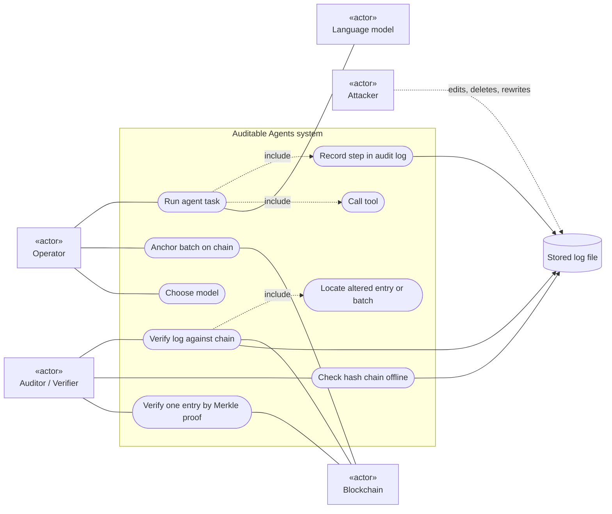
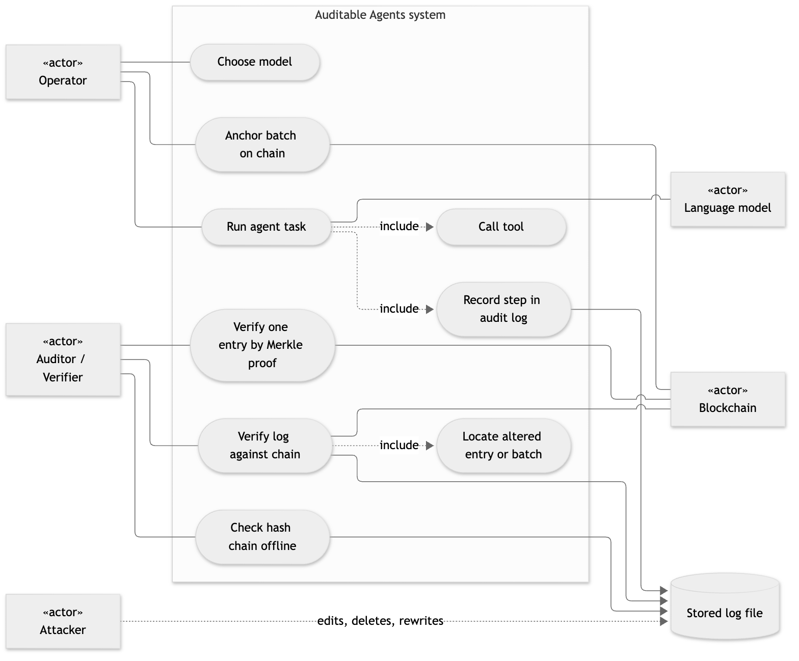

# 01. Use case diagram

**Notation:** UML use case (drawn with Mermaid flowchart notation)  
**Project:** Auditable AI Agents

## What it shows

Who uses the system and what each actor can do. The attacker is outside the system: they act on the stored log file, and the verifier is what notices.

## Diagram

## Where it comes from

`run_agent` (Run agent task, Record step, Call tool), `anchor_pending` (Anchor batch), `verify_against_chain` (Verify and Locate), `scripts/verify_log.py` (offline check), `verifyInclusion` (Merkle proof on-chain), the three model adapters (Choose model).
