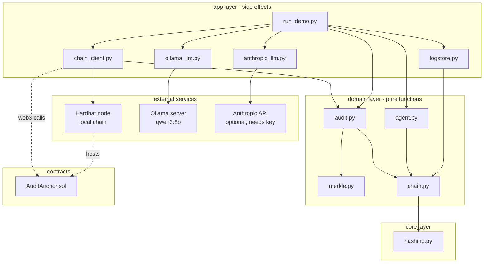
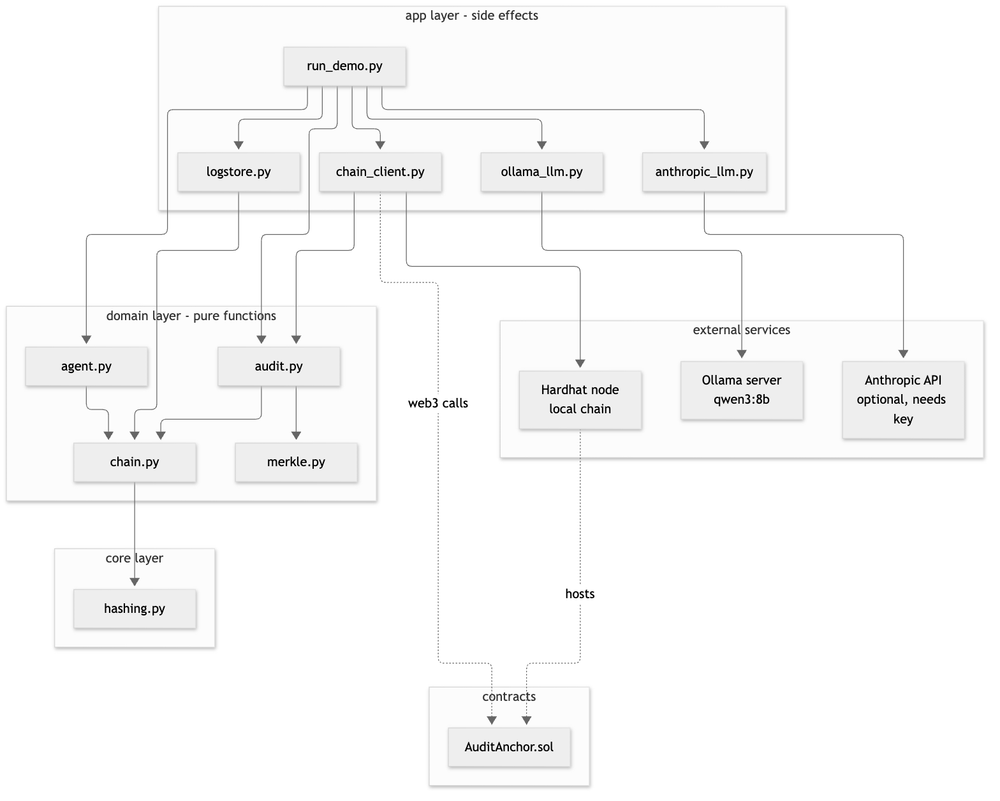

# 02. Component diagram

**Notation:** UML component  
**Project:** Auditable AI Agents

## What it shows

The modules, the layer each belongs to, and what depends on what. Arrows point from the user of a module to the module it uses. `domain` and `core` have no file, network or console access.

## Diagram

## Where it comes from

`src/core`, `src/domain`, `src/app` and `contracts/`. Dotted arrows: the contract runs inside the Hardhat node and is called through web3.
