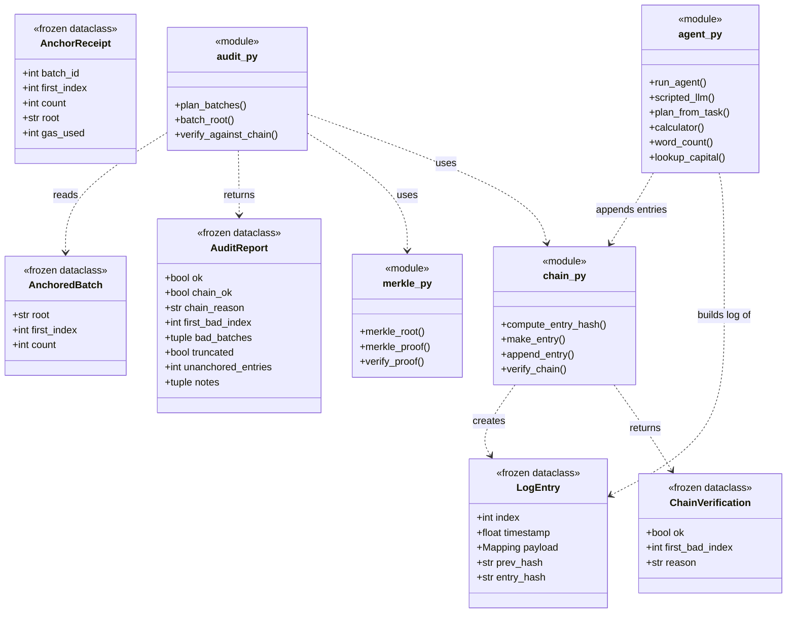
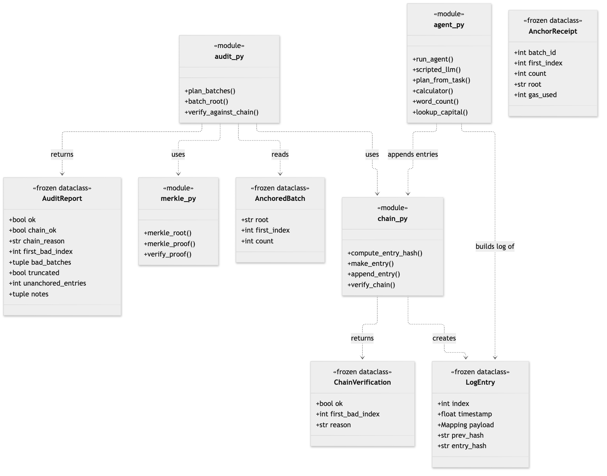

# 03. Class diagram: data model and modules

**Notation:** UML class  
**Project:** Auditable AI Agents

## What it shows

The immutable data types (frozen dataclasses) and the modules of pure functions that create and check them. Function modules are shown as classes marked `module` because Python modules group functions, not objects.

## Diagram

## Where it comes from

`src/domain/chain.py`, `merkle.py`, `audit.py`, `agent.py`; `AnchorReceipt` lives in `src/app/chain_client.py`. All data types are `@dataclass(frozen=True)`, so a log is a tuple that is passed along and returned, never modified.
