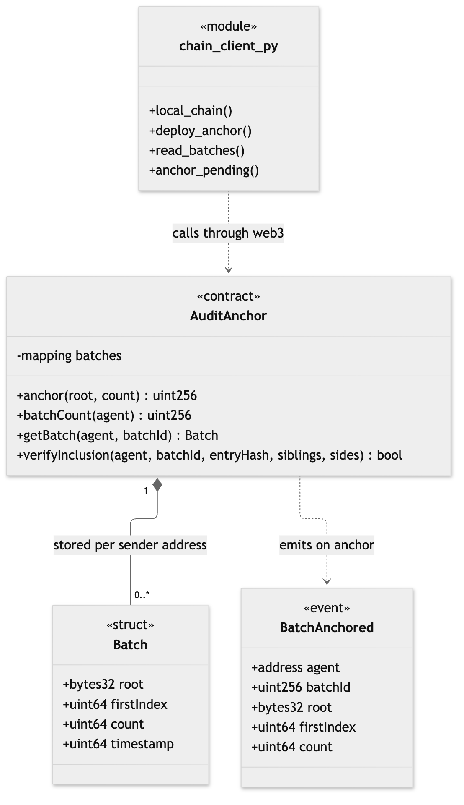

# 04. Class diagram: smart contract and chain client

**Notation:** UML class  
**Project:** Auditable AI Agents

## What it shows

The Solidity contract, its stored structure and event, and the Python client that talks to it.

## Diagram

```mermaid
classDiagram
  class AuditAnchor {
    <<contract>>
    -mapping batches
    +anchor(root, count) uint256
    +batchCount(agent) uint256
    +getBatch(agent, batchId) Batch
    +verifyInclusion(agent, batchId, entryHash, siblings, sides) bool
  }
  class Batch {
    <<struct>>
    +bytes32 root
    +uint64 firstIndex
    +uint64 count
    +uint64 timestamp
  }
  class BatchAnchored {
    <<event>>
    +address agent
    +uint256 batchId
    +bytes32 root
    +uint64 firstIndex
    +uint64 count
  }
  class chain_client_py {
    <<module>>
    +local_chain()
    +deploy_anchor()
    +read_batches()
    +anchor_pending()
  }
  AuditAnchor "1" *-- "0..*" Batch : stored per sender address
  AuditAnchor ..> BatchAnchored : emits on anchor
  chain_client_py ..> AuditAnchor : calls through web3
```

## Where it comes from

`contracts/AuditAnchor.sol` and `src/app/chain_client.py`. There is no function that edits or deletes a batch, so batches are append-only.
