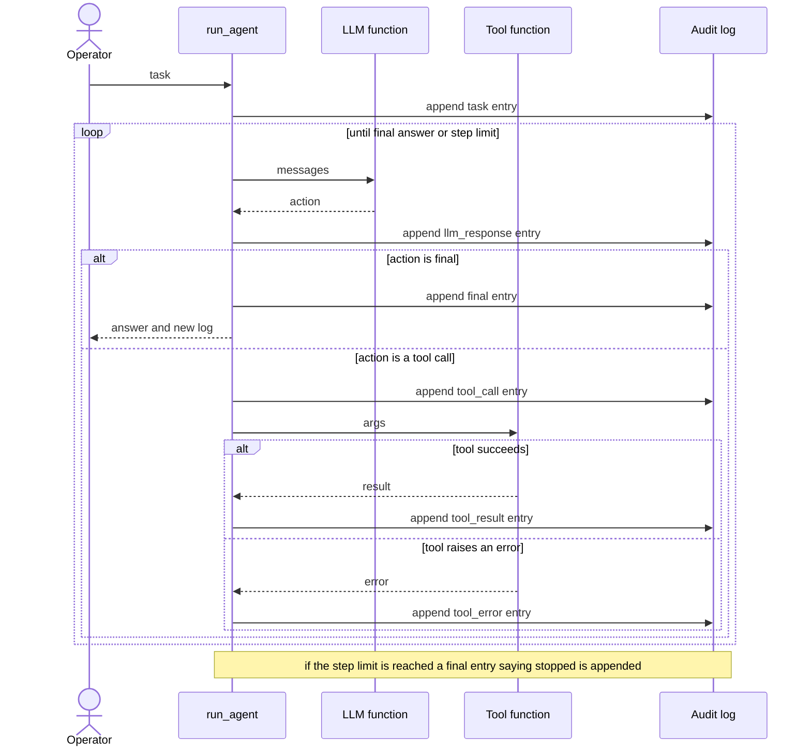
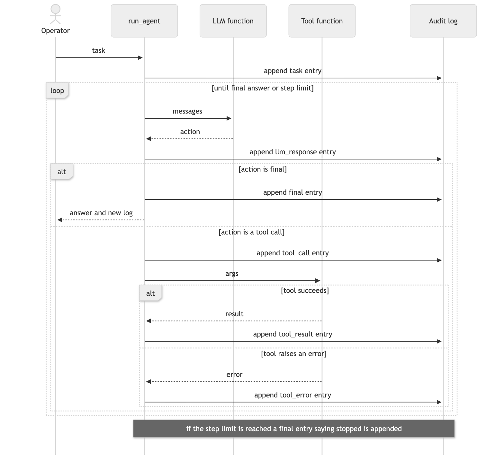

# 05. Sequence diagram: one agent run

**Notation:** UML sequence  
**Project:** Auditable AI Agents

## What it shows

What happens, in order, when the agent handles a task. Every arrow into the audit log is one appended, hash-chained entry.

## Diagram

## Where it comes from

`run_agent` in `src/domain/agent.py`. Entry types: `task`, `llm_response`, `tool_call`, `tool_result`, `tool_error`, `final`.
