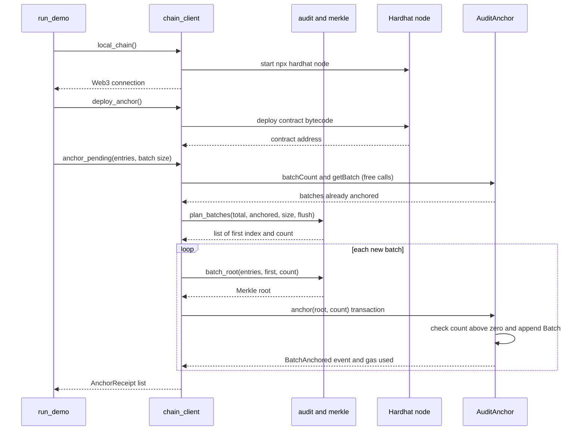
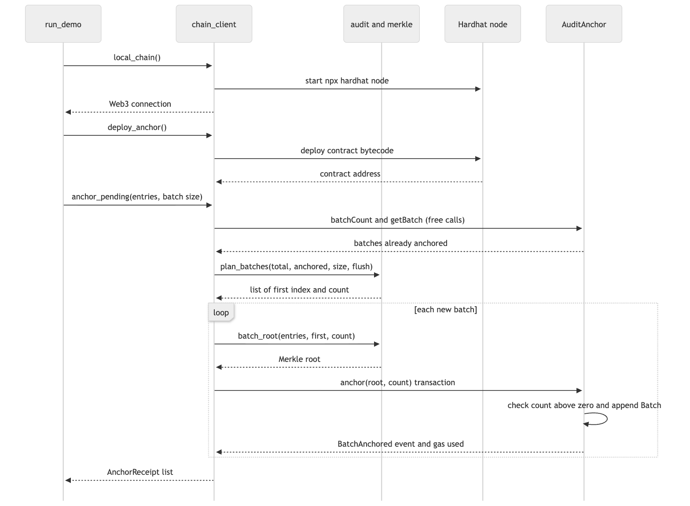

# 06. Sequence diagram: anchoring batches on the chain

**Notation:** UML sequence  
**Project:** Auditable AI Agents

## What it shows

How the demo starts a local chain, deploys the contract and anchors new batches of log entries.

## Diagram

## Where it comes from

`local_chain`, `deploy_anchor`, `anchor_pending` in `src/app/chain_client.py`; `plan_batches`, `batch_root` in `src/domain/audit.py`. What counts as already anchored is read from the chain, so running it twice never anchors a batch twice.
