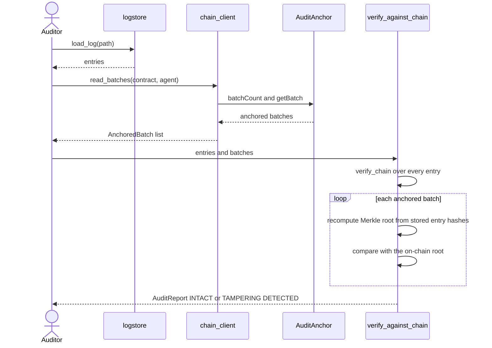
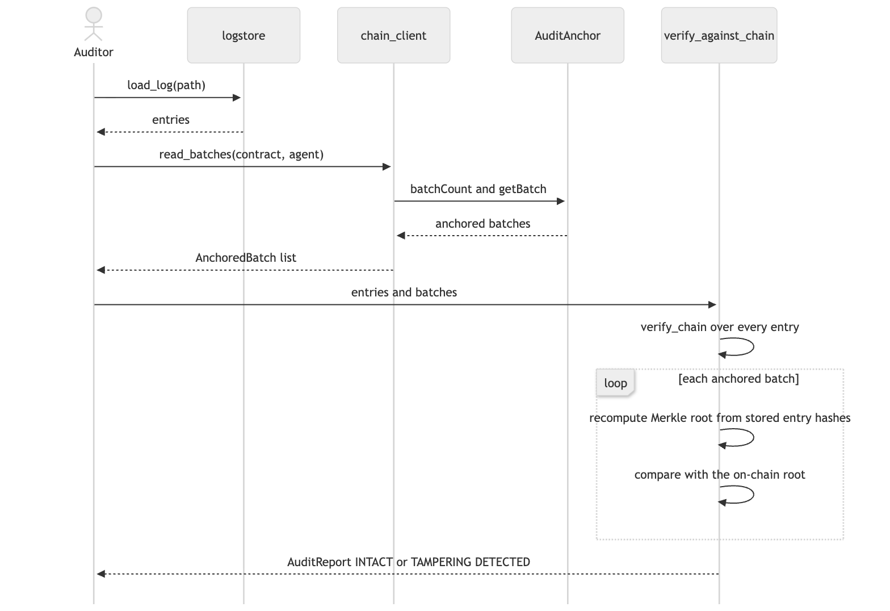

# 07. Sequence diagram: verifying a stored log

**Notation:** UML sequence  
**Project:** Auditable AI Agents

## What it shows

How an auditor checks a log file against the roots on the blockchain.

## Diagram

## Where it comes from

`load_log` in `src/app/logstore.py`, `read_batches` in `src/app/chain_client.py`, `verify_against_chain` in `src/domain/audit.py`.
