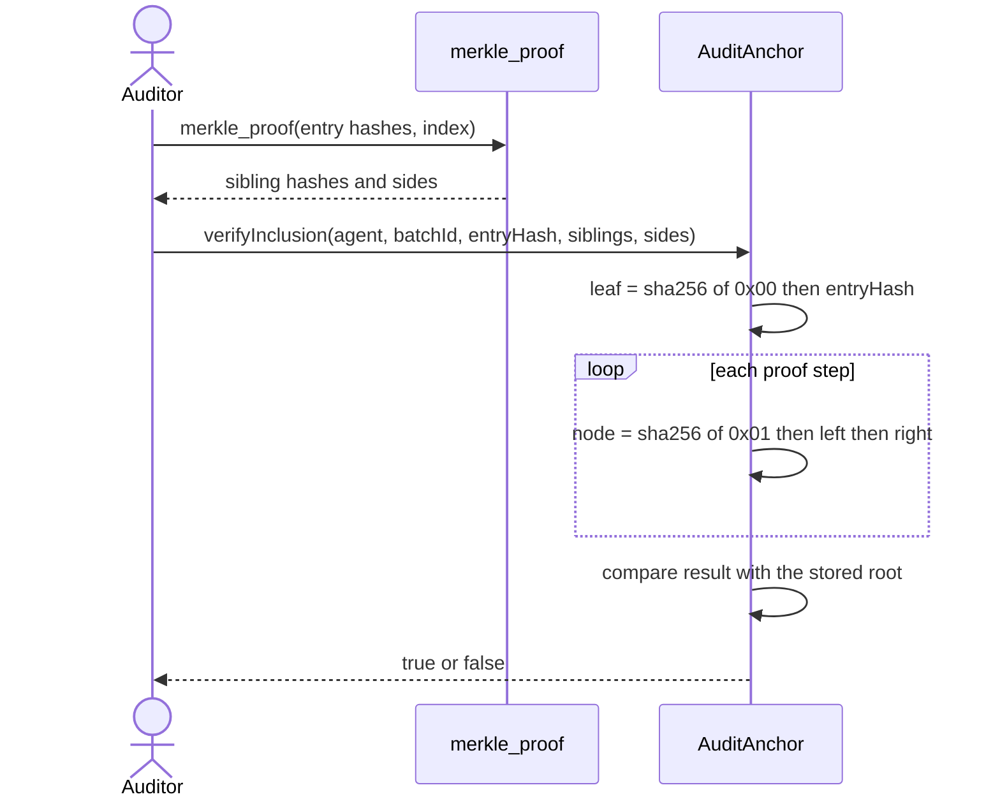
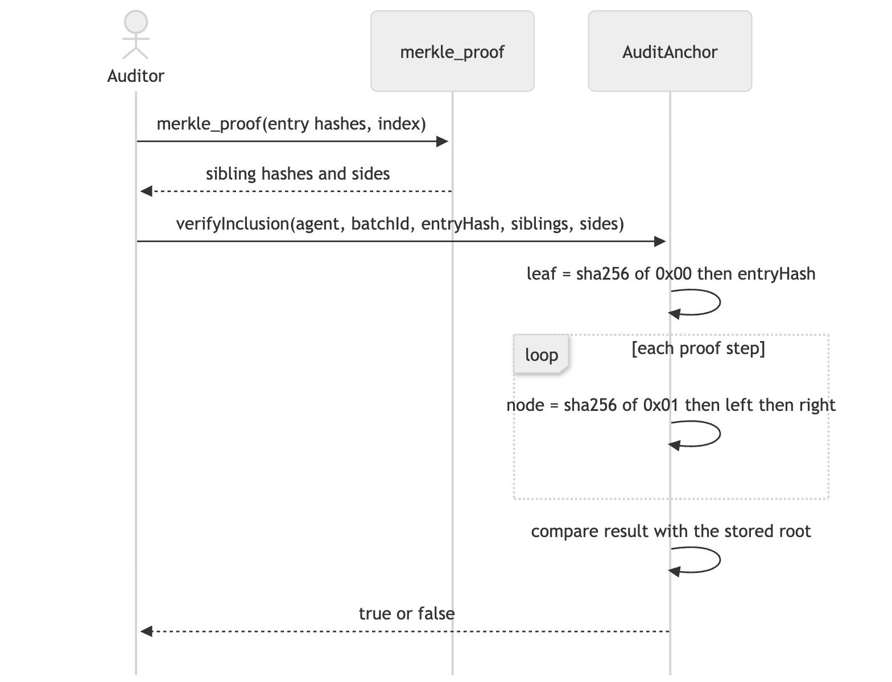

# 08. Sequence diagram: proving one entry belongs to a batch

**Notation:** UML sequence  
**Project:** Auditable AI Agents

## What it shows

How a single entry is proved to be in an anchored batch, with the Python code producing the proof and the contract checking it on-chain.

## Diagram

## Where it comes from

`merkle_proof` in `src/domain/merkle.py` and `verifyInclusion` in the contract. Both use the 0x00 leaf and 0x01 node prefixes, and the Hardhat tests check that every Python proof for trees of 1 to 100 entries verifies on-chain.
