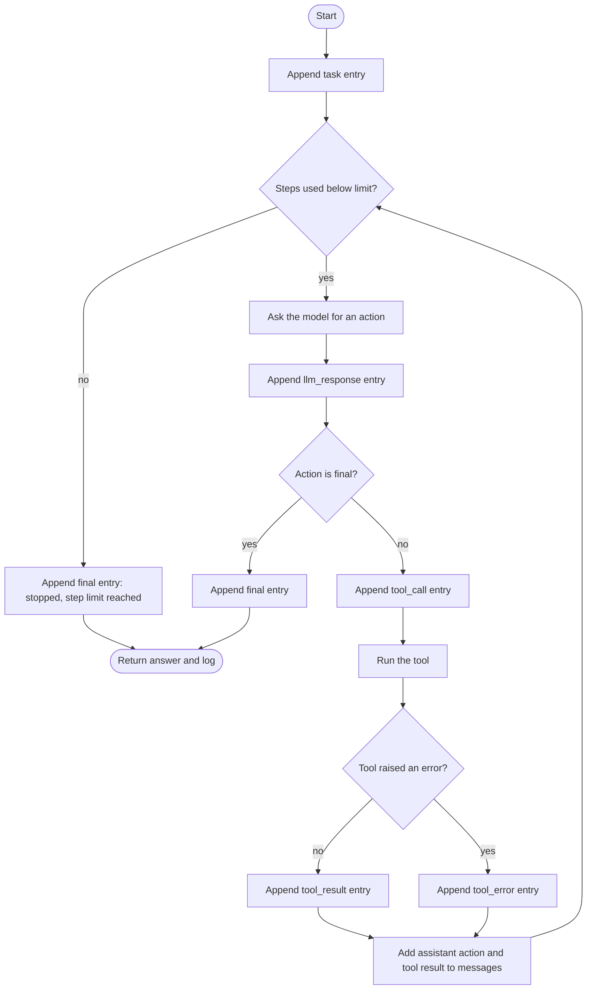
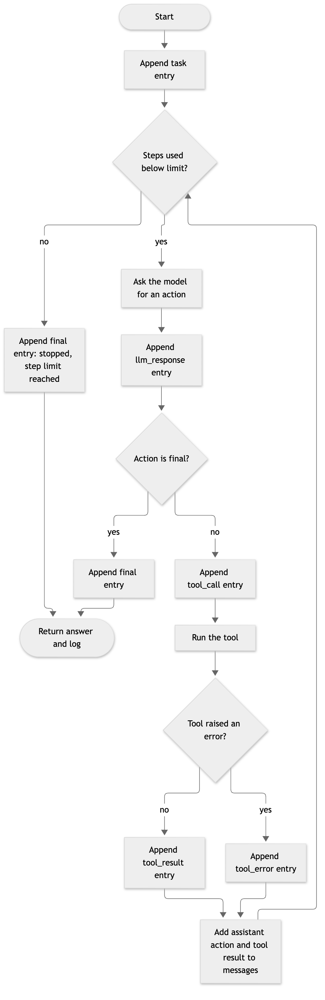

# 09. Activity diagram: the agent loop

**Notation:** UML activity (flow)  
**Project:** Auditable AI Agents

## What it shows

The control flow of `run_agent`, including error handling and the step limit.

## Diagram

## Where it comes from

`run_agent` in `src/domain/agent.py`. Default step limit is 10.
