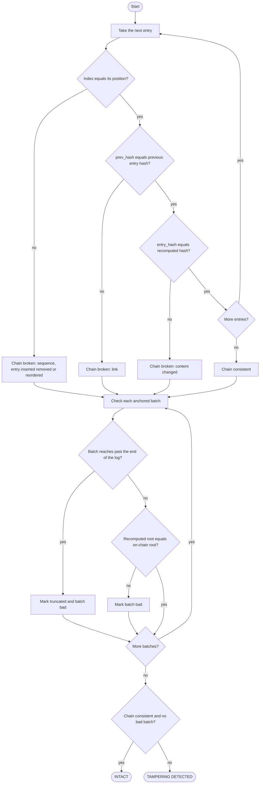
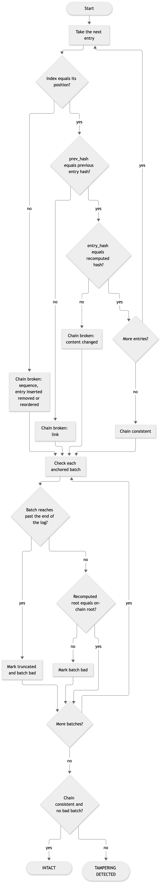

# 10. Activity diagram: the verification algorithm

**Notation:** UML activity (flow)  
**Project:** Auditable AI Agents

## What it shows

The two checks inside verification: the hash chain first, then each batch root against the blockchain, and how the result is decided.

## Diagram

## Where it comes from

`verify_chain` in `src/domain/chain.py` and `verify_against_chain` in `src/domain/audit.py`. If only a batch fails, the report can give the batch range but not the exact entry.
