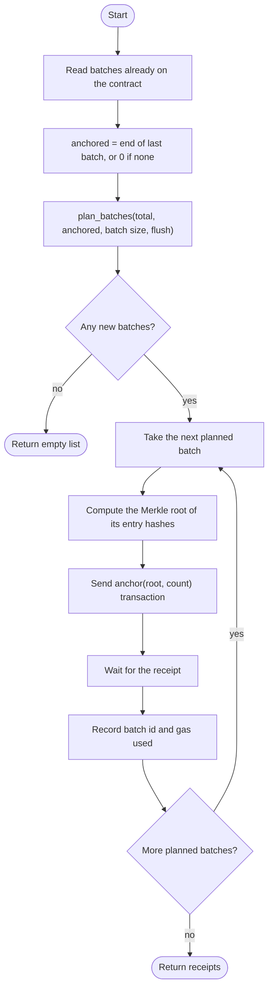
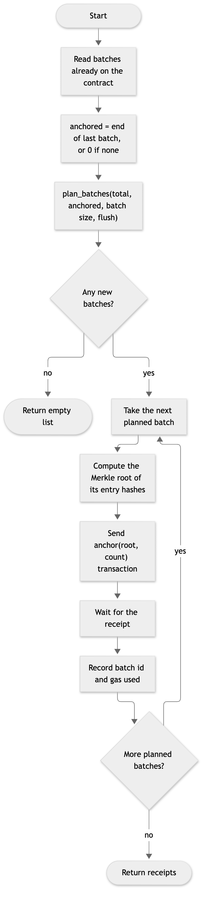

# 11. Activity diagram: the anchoring pipeline

**Notation:** UML activity (flow)  
**Project:** Auditable AI Agents

## What it shows

How `anchor_pending` decides what to anchor and sends one transaction per new batch.

## Diagram

## Where it comes from

`anchor_pending` in `src/app/chain_client.py` and `plan_batches` in `src/domain/audit.py`. A full batch is always anchored; a final partial batch only when `flush` is true.
