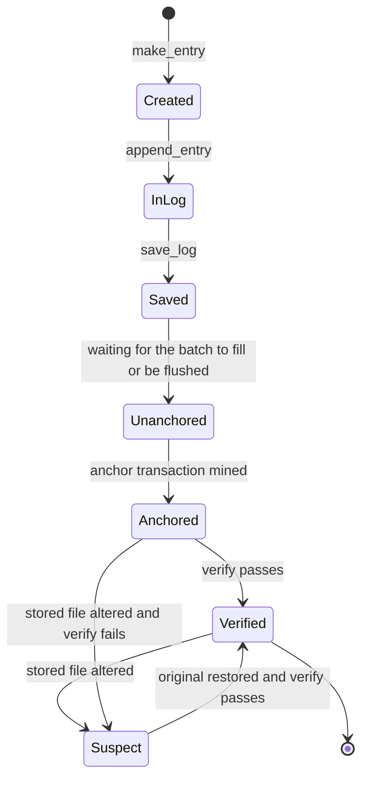
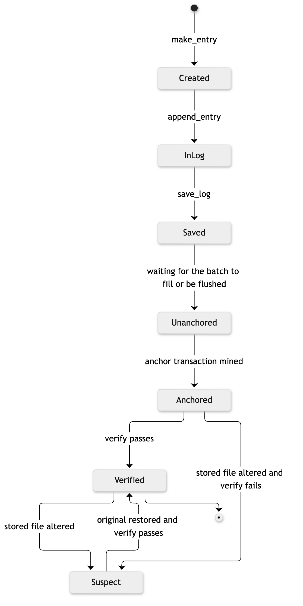

# 12. State diagram: life of a log entry

**Notation:** UML state machine  
**Project:** Auditable AI Agents

## What it shows

The states an entry passes through from creation to verification, including what happens when the stored file is altered and later restored.

## Diagram

## Where it comes from

Matches the demo: edit, consistent rewrite and truncation each move the log to Suspect, and restoring the original returns it to Verified. Entries in Unanchored are not yet protected against a consistent rewrite.
