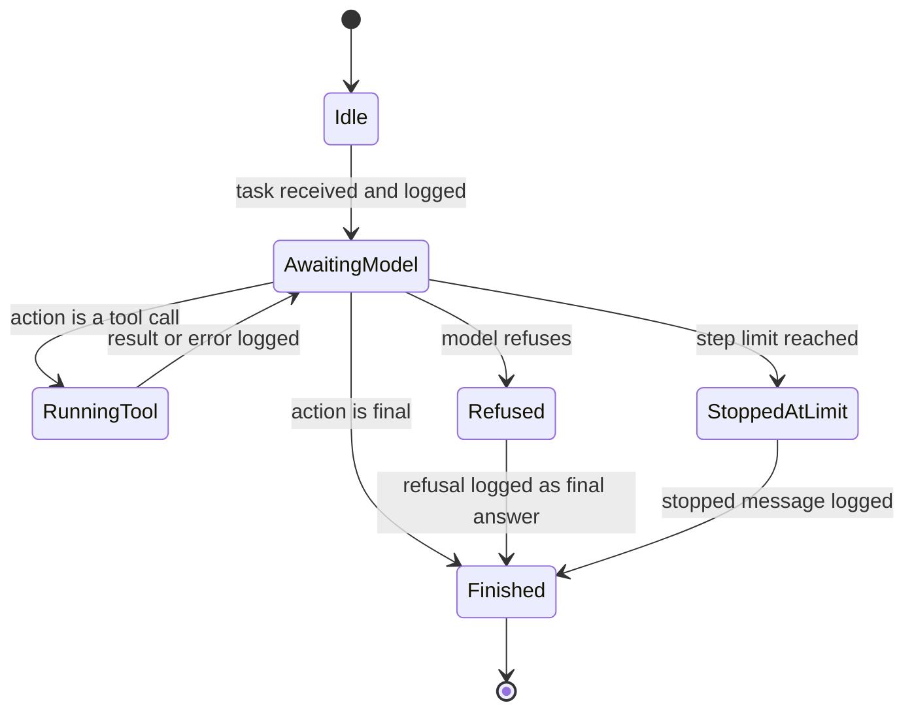
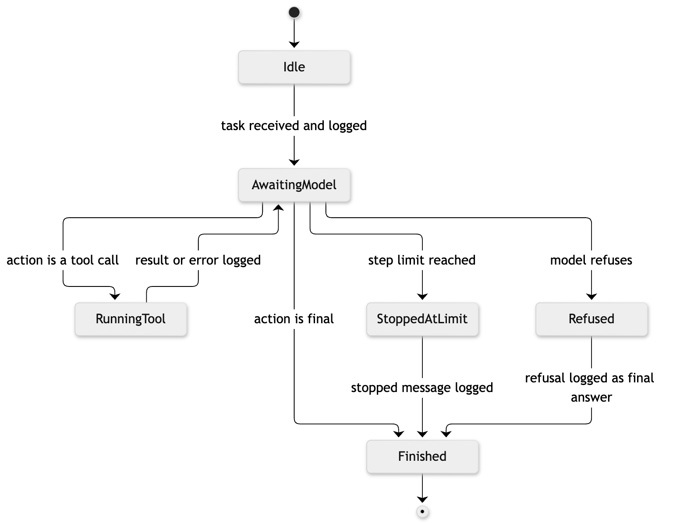

# 13. State diagram: agent run

**Notation:** UML state machine  
**Project:** Auditable AI Agents

## What it shows

The states of one agent run and the ways it can end.

## Diagram

## Where it comes from

`run_agent` in `src/domain/agent.py`. The refusal path comes from the Claude adapter, which turns a refusal into a final answer so it is still logged.
