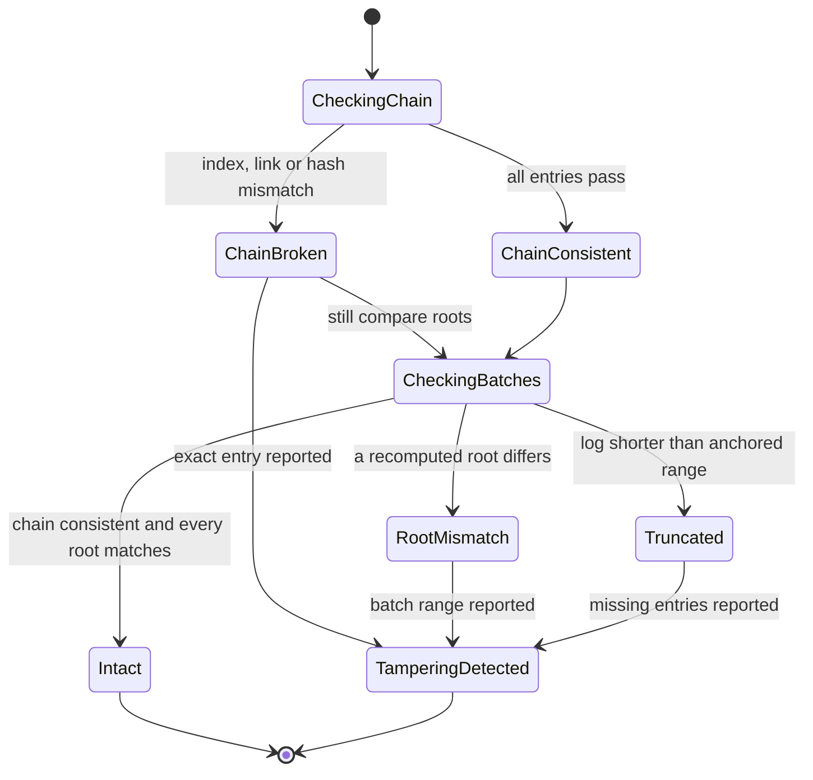
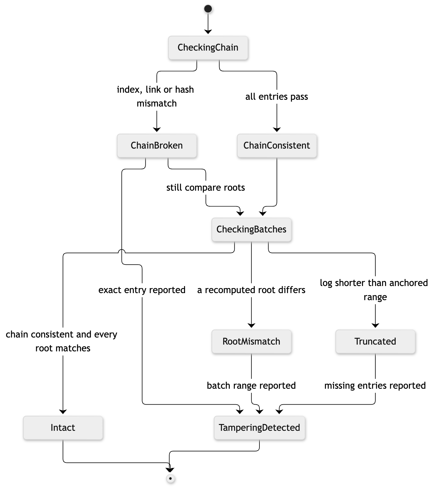

# 14. State diagram: verification outcome

**Notation:** UML state machine  
**Project:** Auditable AI Agents

## What it shows

The states of one verification run and the possible results.

## Diagram

## Where it comes from

`verify_against_chain` returns an `AuditReport` whose `ok`, `chain_ok`, `bad_batches` and `truncated` fields encode these states.
