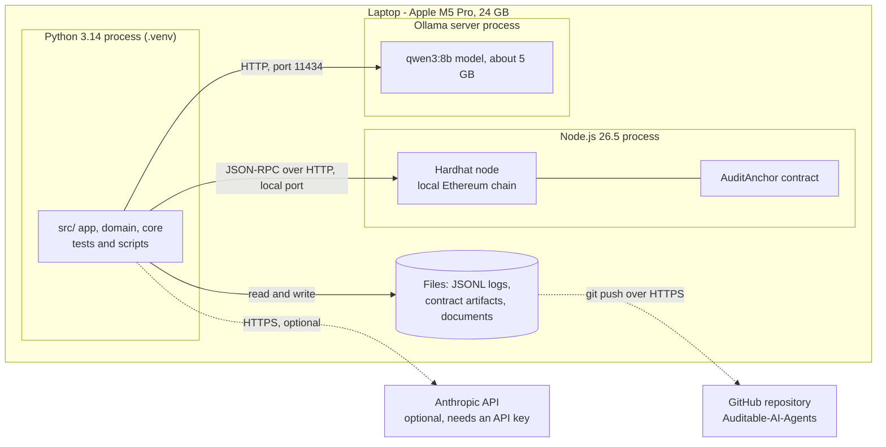
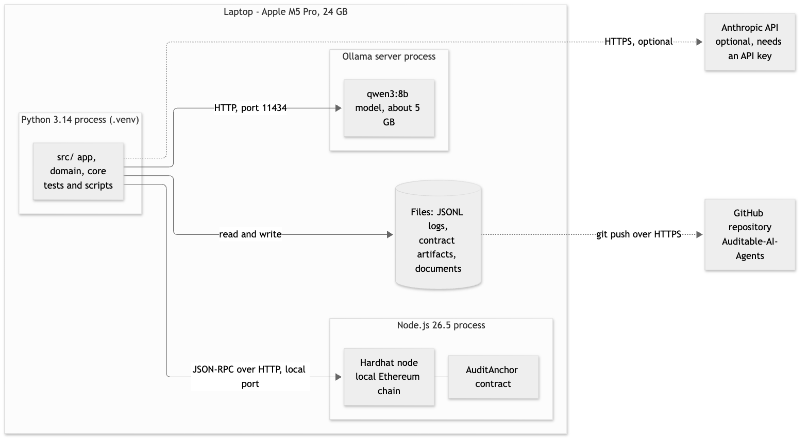

# 15. Deployment diagram

**Notation:** UML deployment  
**Project:** Auditable AI Agents

## What it shows

What runs where during development and the demo. Everything runs on one laptop; the two cloud services are optional or only used for pushing code.

## Diagram

## Where it comes from

`local_chain()` starts the Hardhat node on a free local port for each demo run; `make_ollama_llm` talks to `127.0.0.1:11434`. The Anthropic adapter is unit-tested but has not been run live.
