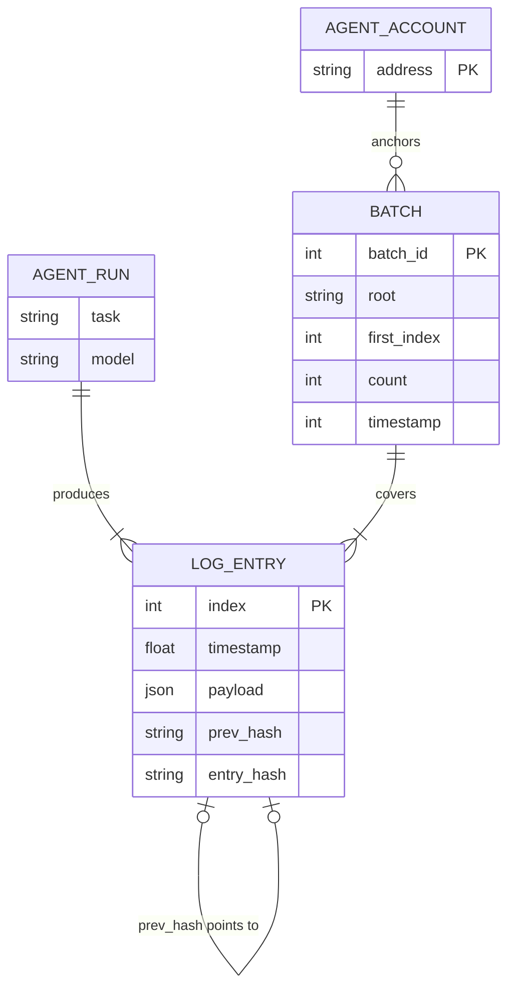
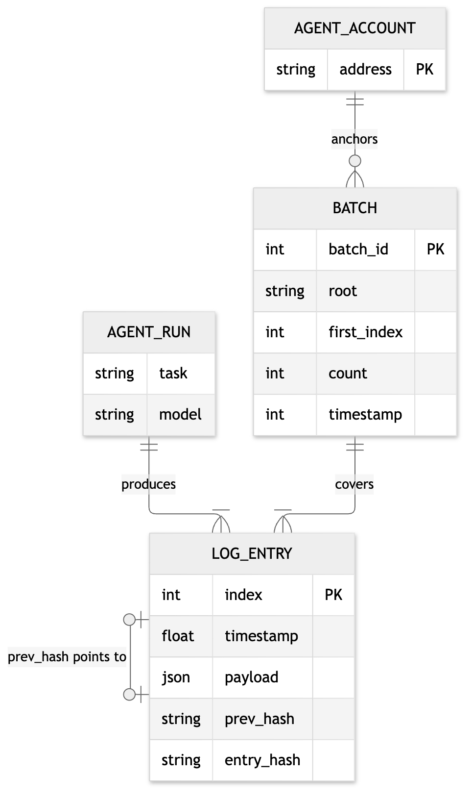

# 16. Entity-relationship diagram: data model

**Notation:** ER (data model)  
**Project:** Auditable AI Agents

## What it shows

The data and how it is split: log entries live off-chain in a file, batches live on-chain in the contract, and each batch covers a range of entries.

## Diagram

## Where it comes from

`LOG_ENTRY` is stored in the JSON Lines file (off-chain). `BATCH` is the `Batch` struct in the contract (on-chain, per sender address). `covers` is the index range `first_index` to `first_index + count - 1`.
