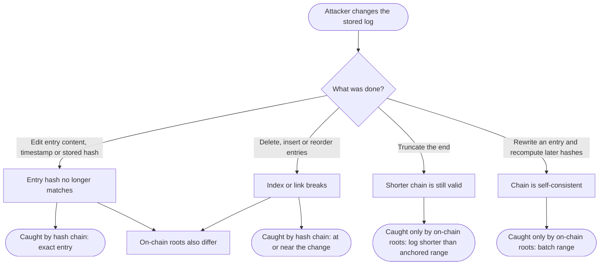
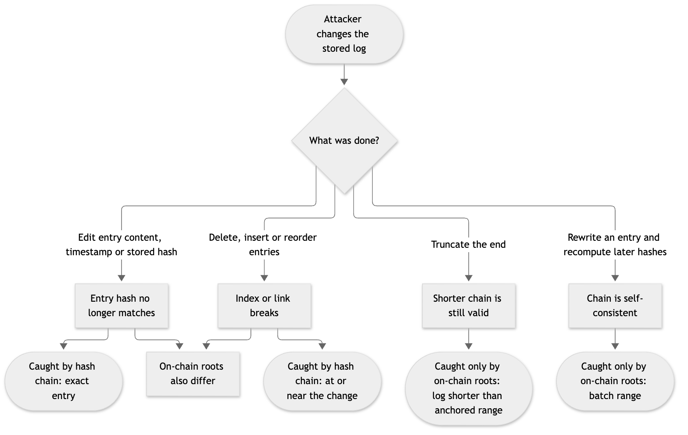

# 17. Flow diagram: which check catches which attack

**Notation:** Decision flow  
**Project:** Auditable AI Agents

## What it shows

For each kind of tampering, whether the hash chain alone catches it and what the on-chain roots add.

## Diagram

## Where it comes from

`tests/test_fuzz_tamper.py` runs each attack on 300 random logs and `docs/TESTING.md` section 7 lists the evidence. Entries after the last anchor are not covered by the roots until the next batch is anchored.
