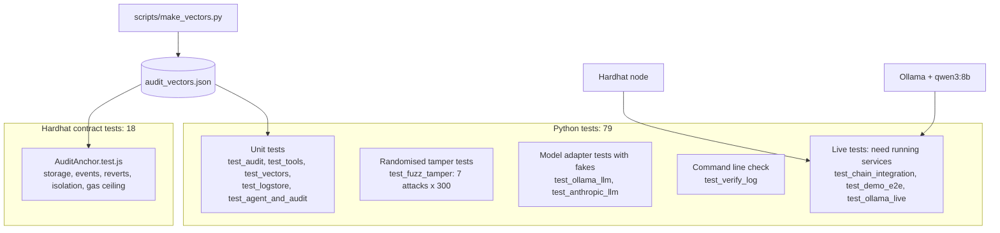
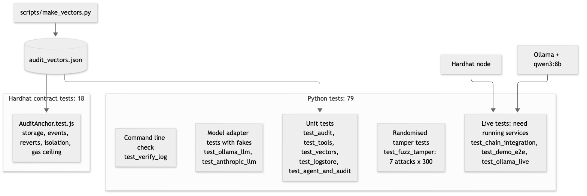

# 18. Test architecture

**Notation:** Package-style map  
**Project:** Auditable AI Agents

## What it shows

The test suites, what they check, and how the two languages are tied together by shared test vectors.

## Diagram

## Where it comes from

`pytest.ini` marks the live tests with `live`; they skip themselves when a service is missing. The vectors file is generated by Python, verified on-chain by Hardhat, and checked for freshness by `test_vectors.py`.
