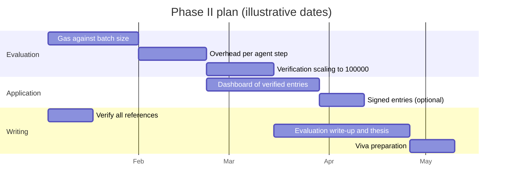
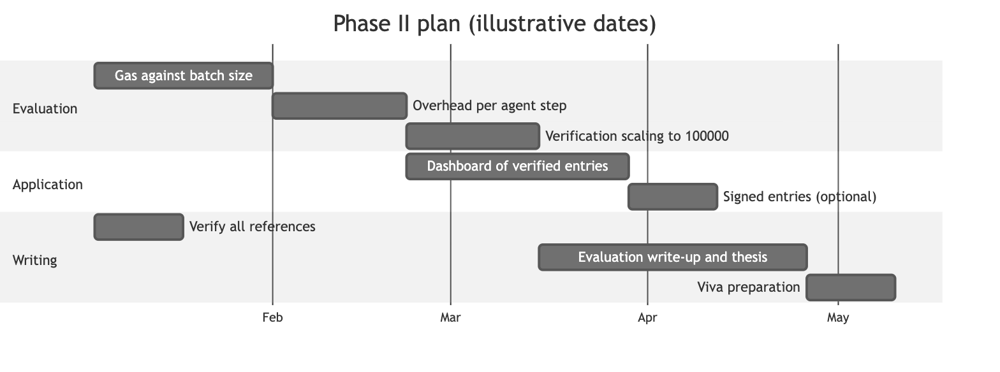

# 19. Phase II work plan (Gantt)

**Notation:** Project plan  
**Project:** Auditable AI Agents

## What it shows

The planned work for next semester. Dates are illustrative: shift the start date to match your semester calendar.

## Diagram

## Where it comes from

`docs/methodology/evaluation-plan.md` (experiments 2 to 4) and Table 6.1 of the Phase I report. This plan is not yet carried out.
